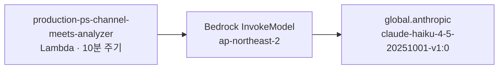

# 2026-10-15 · Bedrock Anthropic AUP 갱신 통지 조사 + Haiku 5.5 등장 확인

## 배경

AWS Health 계정 공지 수신: **[Action Required] Amazon Bedrock Anthropic Usage Policy Update on November 12, 2026**.

발송 트리거는 "최근 30일 내 Anthropic 모델 호출 이력". 사용자가 이벤트 확인 요청.

## 이벤트 성격

| 항목 | 내용 |
|---|---|
| 유형 | `accountNotification` (계정 공지, 장애 아님) |
| 효력 발생 | 2026-11-12 |
| 변경 범위 | Anthropic Usage Policy(AUP) 문서만 갱신 |
| 기술적 영향 | 없음 — 모델 가용성·가격·API 동작·모델 ID 모두 불변 (본문 명시) |
| 요구 행동 | 콘솔 작업 없음. 11-12 이후 계속 호출하면 갱신 약관 동의로 간주 |

참조: https://www.anthropic.com/legal/aup

## ⚠️ Health API 는 이 계정에서 사용 불가

```
aws health describe-events          → SubscriptionRequiredException
aws health describe-event-aggregates → SubscriptionRequiredException
aws support describe-severity-levels → Premium Support Subscription is required
```

계정이 Basic/Developer 지원 플랜이라 **AWS Health API 자체가 막혀 있음** (Business 이상 필요).
콘솔의 AWS Health Dashboard 는 플랜 무관하게 열리지만 CLI/API 경로는 없음.

EventBridge 에도 `aws.health` 소스 룰 없음 (`ap-northeast-2`, `us-east-1` 양쪽 확인).
→ Health 이벤트는 현재 **이메일 수신 외 자동 수집 경로가 전무**.

(레포의 `infra-health` 영역은 CloudWatch 메트릭 임계 점검이며 AWS Health 이벤트와 무관.)

## 영향권 식별 — 호출 주체 역추적

Health API 가 막혀 CloudWatch + CloudTrail 로 우회 조사.



- **모델**: `global.anthropic.claude-haiku-4-5-20251001-v1:0` (글로벌 cross-region 추론 프로파일)
- **리전**: `ap-northeast-2` 단독. `us-east-1`·`us-west-2` 에는 Bedrock 호출 메트릭 없음
- **호출 주체**: Lambda `production-ps-channel-meets-analyzer`
  - nodejs20.x, role `custom-lambda-role-production`, 최종 수정 2026-08-06
  - env: `SSTATE=production`, `TZ=Asia/Seoul`
- **호출량**: 30일 누적 약 1,300회, 평일 40~90회/일 (10분 간격 정기 실행)

→ 이 공지의 실제 대상은 **운영 Lambda 1개**.

조사 방법 (재사용 가능):
```bash
# 어떤 Bedrock 모델이 호출되는지
aws cloudwatch list-metrics --namespace AWS/Bedrock --metric-name Invocations \
  --region ap-northeast-2 --query 'Metrics[].Dimensions[?Name==`ModelId`].Value' --output text

# 누가 호출하는지 (CloudTrail 관리 이벤트)
aws cloudtrail lookup-events --region ap-northeast-2 \
  --lookup-attributes AttributeKey=EventSource,AttributeValue=bedrock.amazonaws.com \
  --query 'Events[].{T:EventTime,N:EventName,U:Username}' --output text
```

## 부수 발견 — Bedrock 에 5.5 세대 등록됨

이벤트와 **무관한 별건**이나, 조사 중 확인됨. `ap-northeast-2` 에 Claude 5.5 세대가 ACTIVE 상태로 올라와 있음.

| 항목 | 현재 사용 중 | 신규 |
|---|---|---|
| 모델 ID | `anthropic.claude-haiku-4-5-20251001-v1:0` | `anthropic.claude-haiku-5-5` |
| 추론 프로파일 | `global.anthropic.claude-haiku-4-5-20251001-v1:0` | `global.anthropic.claude-haiku-5-5` |
| 상태 | ACTIVE | ACTIVE |
| 입력 모달리티 | TEXT, IMAGE | TEXT, IMAGE |
| 스트리밍 | 지원 | 지원 |
| 추론 타입 | — | `INFERENCE_PROFILE` 전용 |

같이 올라온 5.5 세대: `anthropic.claude-opus-5-5`, `anthropic.claude-sonnet-5-5`.

**주의:** Haiku 5.5 는 `inferenceTypesSupported` 가 `INFERENCE_PROFILE` 하나뿐 — 온디맨드 직접 호출 불가, `global.` 프로파일 ARN 필수. 현재 Lambda 도 이미 `global.` 프로파일 경유라 호출 방식 자체는 동일.

**단가:** Bedrock 은 파트너 과금이므로 5.5 단가는 https://aws.amazon.com/bedrock/pricing/ 별도 확인 필요.

## 후속 (실행 안 함)

1. **AUP 갱신본 대조** — 법무·보안 검토 사항. `production-ps-channel-meets-analyzer` 가 채널 미팅 데이터를 다루므로 **입력에 개인정보·고객 발화가 포함되는지**가 검토 포인트.
2. **Haiku 4.5 → 5.5 교체 검토** — 사용자가 직접 진행 예정 (2026-10-15 명시). 함수 소스에서 모델 ID 지정 방식·프롬프트 확인 선행 필요. 운영 자원이므로 임의 변경 금지.
3. **Health 이벤트 수집 경로 부재** — EventBridge `aws.health` 룰로 Telegram/Slack 전달 가능. 미제안 상태.

관련: [[protected-resources]] · [[aws-pending]]
